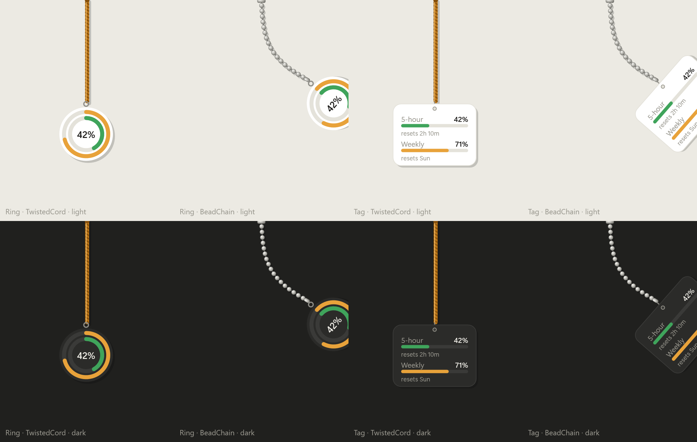

# TokenBob

A hanging, physics-driven Claude usage meter for Windows — 5-hour and weekly limits at a glance.

> **Status:** in development. See the [design spec](docs/superpowers/specs/2026-10-14-tokenbob-design.md).



## Build from source

Requires the .NET 10 SDK on Windows.

```powershell
dotnet build
dotnet test
dotnet run --project src/TokenBob.App
```

## License

[MIT](LICENSE)
